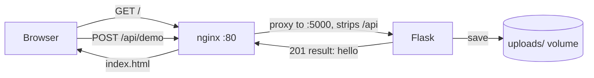

# Flask File Upload Demo

Minimal demo of uploading a file from a browser to a Flask API, with nginx serving the static client and proxying API requests.

## Overview

The page picks a file, posts it as `multipart/form-data` to `/api/demo`, Flask sanitizes the filename, saves it to `uploads/`, and returns JSON that the page displays. The client and API run as two containers behind a single nginx origin.

## Tech stack

| Layer | Technology |
| --- | --- |
| API | Python 3, Flask 3.1, Flask-CORS |
| Upload handling | Werkzeug `secure_filename` |
| Front end | HTML + vanilla JS, axios (CDN) |
| Tests | pytest (Flask test client) |
| Web server / proxy | nginx (`nginx:stable-alpine`) |
| Packaging | Docker, Docker Compose |

## Request flow



## API

| Method | Path | Description | Response |
| --- | --- | --- | --- |
| `GET` | `/` | Health check | `200 Hello, World!` |
| `POST` | `/demo` | Accepts `multipart/form-data` with a `file` field, saves it to `./uploads/` | `201 {"result":"hello"}` |

A missing or empty `file` field returns `400 {"error": "missing file field 'file'"}`. The upload folder is created on startup if it does not exist.

```bash
curl -F "file=@./README.md" http://localhost:5000/demo
# {"result":"hello"}
```

## Setup and deployment

Docker (recommended):

```bash
docker compose up --build
```

- Client: <http://localhost:8000>
- API: <http://localhost:5000>

Local run:

```bash
cd server
python3 -m venv .venv && source .venv/bin/activate
pip install -r requirements.txt
flask --app app run --debug --port 5000
```

Run the tests (from `server/`):

```bash
pip install -r requirements-dev.txt
pytest
```

The page posts to `/api/demo`, so it needs the nginx proxy; for local use, point the axios `url` at `http://localhost:5000/demo` (CORS is enabled).

There is no public deployment. To host it, run `docker compose up -d` behind a TLS-terminating reverse proxy; put a production WSGI server in front of Flask instead of `flask run`.

## Demo

```bash
docker compose up --build
```

Open <http://localhost:8000>, choose a file, click **Predict**. The response (`hello`) appears on the page and the file lands in `./uploads/` on the host.
